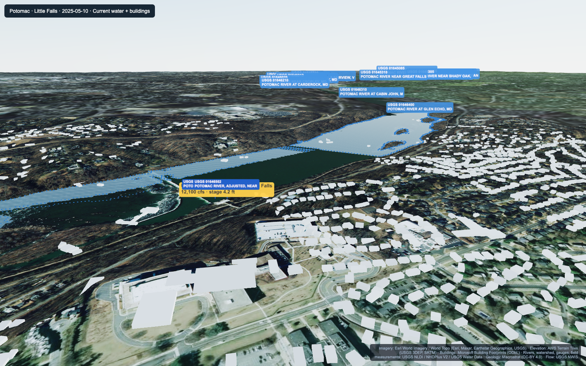
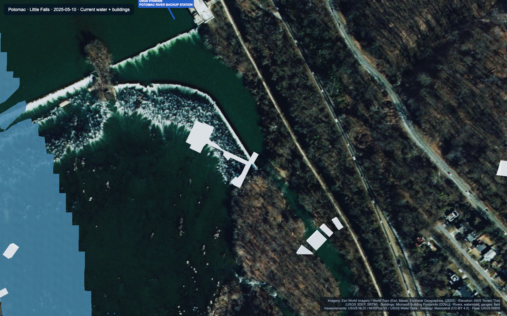
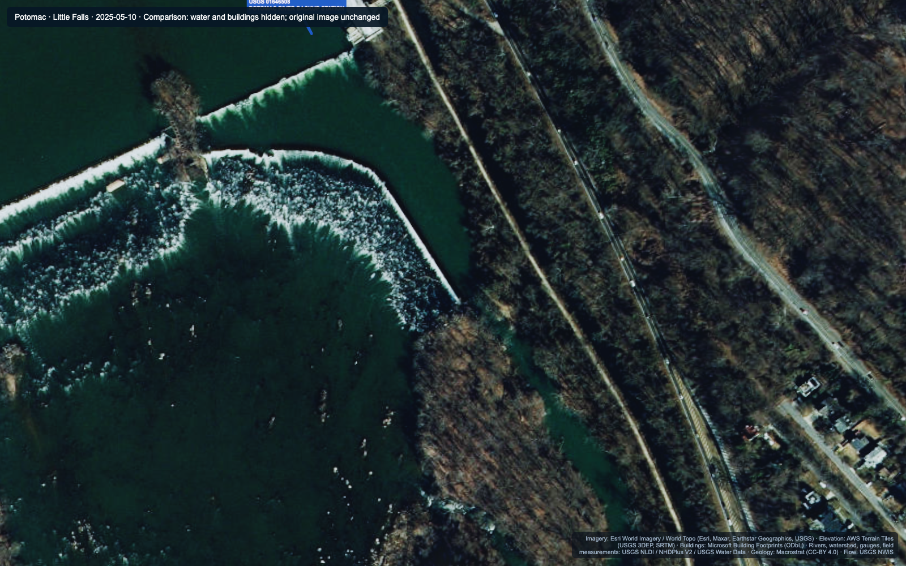
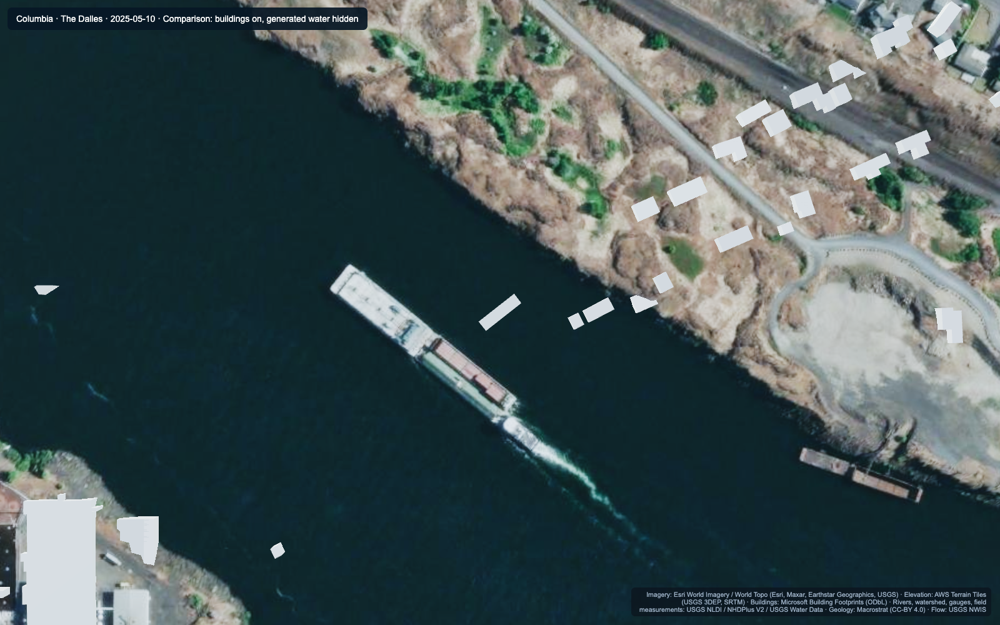
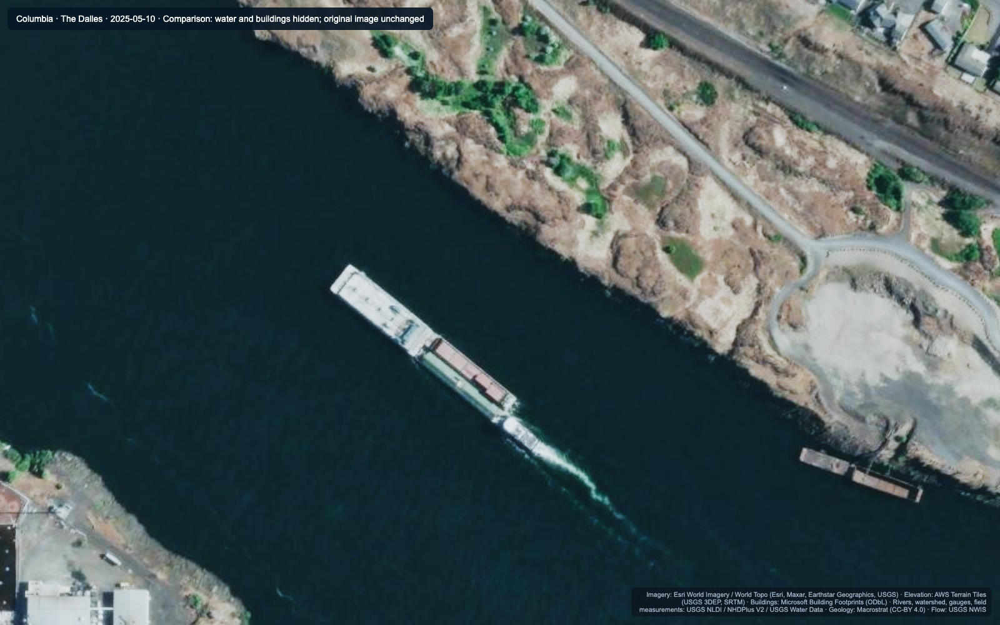
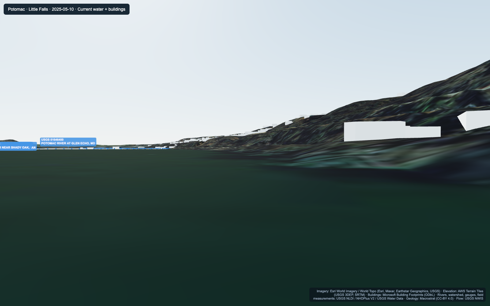
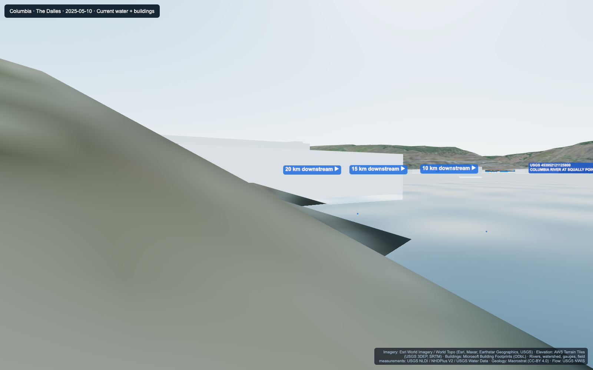

# River scene diagnosis — 9 November 2026

The current local HydroTwin app was run for Columbia / The Dalles (14105700) and Potomac / Little Falls (01646500). The defects were reproduced after imagery and buildings had finished loading. Camera movement performance was excluded from this diagnosis.

## Main finding

The representation has several separate problems: questionable source building footprints, simple untextured building extrusion, approximate water coverage, and insufficient ground-level 3D detail. It is not established that the entire building layer has a common horizontal coordinate offset.

## 1. Potomac river coverage disagrees with the photographed river — confirmed

The blue generated surface covers portions of the dark photographed river but leaves a large neighboring water area without generated water. The edge changes abruptly through the visible river. The same close-up camera is available with overlays on and off below.

The code obtains river centerlines from USGS NLDI and seeds an approximate connected-cell flood fill on the terrain. It does not use mapped bank polygons for the base river footprint. The water mesh draws both triangles of a grid square when any corner is wet. This produces a stepped boundary and can include extra dry corners. Main-channel centerlines and this heuristic do not establish all branches, pools, islands, or historical inundation.

Relevant source: `stations/USGS-01646500-3d.html` and the equivalent Columbia file, `WaterGrid.setLevel`, `Flood.fill`, `initGroundFlood`, `riverPath`, `bedSeq`.

## 2. Questionable building footprints exist independently of the generated water — confirmed source inconsistency; individual classification remains open

Several white building shapes lie in areas shown as open water in the underlying imagery. They remain in place when our water mesh is hidden, so these examples cannot be explained solely by our blue overlay covering correctly placed land buildings. Some land footprints also disagree with the current photograph. This is consistent with classification errors or different source capture dates; a uniform layer translation has not been demonstrated.

The app uses embedded `BAKED_BUILDINGS` rather than making a live building API request. A check against independent USGS waterbody polygons flagged these footprint centers inside mapped water:

| Station | Rendered footprints | Centers inside mapped water | All footprint vertices inside mapped water |
|---|---:|---:|---:|
| Columbia | 2,144 | 40 | 30 |
| Potomac | 2,300 | 35 | 26 |

These are review candidates, not a count of proven invalid buildings. Bridges, piers, intake works and other legitimate structures can sit over water. Waterbody mapping and imagery also have different dates. Footprints must be classified or checked rather than deleted solely because they overlap water.

The reference geometry was queried from USGS 3DHP Waterbody layer 60. The local returned polygons are legacy NHD features (feature date 2023-09-14), not newly surveyed contemporary shorelines. Columbia's main reference waterbody is Lake Bonneville, the reservoir reach through The Dalles. Potomac returns two River polygons. Query URLs and timestamps are saved in `reference-waterbody-provenance.json`.

## 3. Buildings are uniform, untextured boxes — confirmed

Potomac has 2,300 bundled footprints; Columbia has 2,192, of which 2,144 pass the detailed-block bounds filter. None of either station's bundled entries includes a height or floor-count tag. `loadBuildings()` therefore uses its default 7-meter height. The rendered building material has vertex colors and no facade or roof image texture.

The models can look like large white blocks even where their footprint location is reasonable. New footprint coordinates alone would not supply realistic facades, roofs, building heights or vegetation.

## 4. Ground-level views reveal the limits of a photo draped over terrain — confirmed

The automatic Riverbank presets produce flat, stretched foregrounds and plain building walls; Columbia also has a large foreground surface obscuring the scene. These views do not support the desired camera-like experience. The preset is selected from a coarse terrain grid and a median-flow approximation. Its exact foreground occlusion has not been isolated to one geometry object, so it is recorded as a visible defect rather than a proven below-ground camera diagnosis.

Measured configured spatial sampling:

| Station | Detailed terrain / water mesh spacing | Desktop image sampling over detailed block | Outer terrain spacing |
|---|---:|---:|---:|
| Columbia | 8.91 m | 0.84 m per image pixel | 133.68 m |
| Potomac | 9.91 m | 0.93 m per image pixel | 148.61 m |

The detailed image is fully loaded at 4096×4096 in both captures. Thus the low ground-level fidelity is still present after loading. These are configured sampling distances, not claims about the original imagery's native resolution or survey accuracy. Trees and many small objects are only photographs on the terrain, not 3D objects.

## 5. Water height is anchored to an assumption — confirmed code behavior; physical error is unquantified

`QDEM` assumes the terrain's water surface corresponds to the 25th-percentile flow from the supplied record. Stage changes are applied relative to that assumption. This is not a measured image-acquisition water level or a verified link between gauge datum and terrain datum. It can affect coverage independently of image sharpness. The present investigation does not quantify the true physical water-elevation error.

## What the run did and did not establish

- Both scenes finished loading terrain imagery and buildings. No terrain/imagery/river request failures or JavaScript exceptions were recorded in this capture run. An optional local `data/pulls/manifest.json` and favicon returned 404; these do not establish a building API outage.
- A previous code-path risk remains: missing elevation tiles can be decoded as invalid low elevations. No missing elevation-tile request was recorded here, so that is not presented as the cause of these screenshots.
- Screenshots use a selected river date of 2025-05-10. The imagery capture date is not established as that day. Visual disagreement demonstrates inconsistent layers, but does not by itself prove the real flood extent on the selected date.
- Baseline captures retain the original app. Comparison captures temporarily hide selected layers and panels in a separate browser. All original geometry and imagery remain unchanged. Each comparison image is labeled. Source credit remains visible.
- Captures were made in desktop Chrome at 1600×1000 using software WebGL for repeatable image inspection. No headset or frame-rate claim is made.
- The two river HTML source hashes were verified unchanged after capture. No application fix was made during this diagnosis.

## Recommended order for subsequent implementation

1. Establish a credible base river footprint using mapped water polygons checked against aerial imagery, preserving islands and branches. Keep uncertain forecast inundation visually distinct from that base footprint.
2. Validate building footprints against imagery and water; distinguish genuine water infrastructure from false or obsolete detections. Retain provenance and available height information.
3. Improve the actual 3D environment: detailed local terrain, suitable imagery and genuine 3D building/vegetation content where available. Confirm that any provider covers the exact reach.
4. Resolve vertical-reference and acquisition-date consistency before describing dynamic water extents as a physically accurate digital twin.

The original app remains at http://127.0.0.1:8783/. The full screenshot comparison report is `index.html` in this folder.
